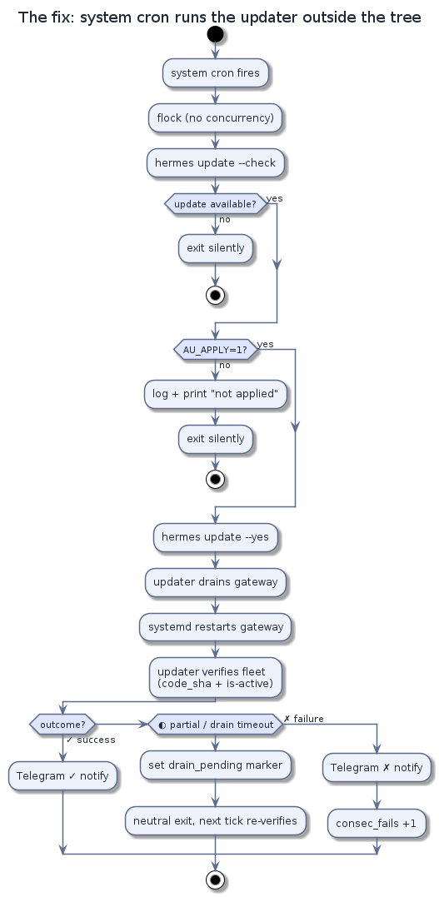

# Hermes Auto-Update

[简体中文](README.md) · English

Hands-off [Hermes Agent](https://github.com/NousResearch/hermes-agent) updates via a system-cron job outside the gateway process tree; notifies Telegram only for real outcomes.

Current version: **updater v5.15** (this is the updater's own version — distinct from the Hermes version it installs).

## Support boundary / disclaimer

Hard-resets a git checkout and restarts a gateway as root, unattended. Linux + systemd + git installs only. Best-effort support.

## Why system cron, not hermes cron

<p align="center"></p>

A hermes-cron job lives inside the gateway process tree — the root of every update race: the updater can only signal a restart after it exits, waiting inside the script deadlocks, and the fleet check reports STALE. Out of the tree the updater drains the gateway, restarts it via systemd, and verifies the fleet itself before exiting, so the script can verify synchronously.

<p align="center"></p>

(Diagram sources: `assets/src/in-tree-deadlock.en.puml`, `assets/src/out-of-tree-flow.en.puml` — regenerate with `plantuml -tpng`.)

## Install

```bash
bash install.sh          # preconditions check ONLY — never runs the updater
```

The recommended schedule (install.sh prints it; crontab.txt carries it):

```cron
23 3 * * * set -a; [ -f $HOME/.hermes/scripts/auto_update.env ] && . $HOME/.hermes/scripts/auto_update.env; set +a; AU_APPLY=1 $HOME/.hermes/scripts/auto_update.sh >> $HOME/.hermes/logs/auto_update_cron.log 2>&1
```

`set -a` is not decoration: without it the env file delivers NOTHING to the script (a bare `. file` sets variables in the scheduler shell, which exits immediately, and the updater never sources the file itself). The `[ -f ]` guard keeps a not-yet-created env file from aborting the line before `AU_APPLY=1` is delivered. `scripts/schedule_delivery.sh` runs this shape under bash/dash/sh with the env file present and absent, and reports what the child inherited.

## Per-host values

| variable | why |
|---|---|
| `AU_APPLY=1` | REQUIRED in the scheduler command — absent = report-only, never installs |
| `TG_PROXY=""` (or empty value) | direct Telegram. **Must live in `~/.hermes/scripts/auto_update.env`** — the file the scheduler sources. A copy in `~/.hermes/.env` never arrives (the script reads that file only for bot token + chat id). Empty value is meaningful, never delete the var. |
| `AU_REPO_DIR` / `AU_HERMES_BIN` | non-default checkout / binary paths |
| `AU_GATEWAY_STATE` / `AU_GATEWAY_UNIT` / `AU_CRON_UNIT` | systemd specifics |
| `AU_REALERT_SECS` | wall-clock re-alert interval for persistent failures, seconds; default `259200` (3 days); `0` = every tick. Non-numeric values fall back to the default |
| `AU_AHEAD_REMIND_SECS` | reminder interval for "checkout newer than the selected release", seconds; default `604800` (7 days) |

See SKILL.md + references/wsl-deployment.md for the full checklist.

## Notification design

Silence when up to date. `✓` on install (headline the Hermes version, name the updater version), `✗` on failure (at once, then every `AU_REALERT_SECS` while it persists). `⚠` once the check has been abnormal (`--check` exit≠0, or output not recognized) 3 times in a row, then every `AU_REALERT_SECS` of **wall-clock** time (default 3 days). The alert carries the real error line (a `✗` line first), the streak length and the last successful install time.

`hermes update --check` output is classified by line-anchored phrases taken from Hermes `hermes_cli/update_cmd_check.py` (upstream has no machine-readable output):

| Hermes prints | class | action |
|---|---|---|
| `⚕ Update available…` (main) / `→ Selected release available: …` (stable) | available | install (needs `AU_APPLY=1`) |
| `✓ Already up to date.` / `✓ No newer release: …` / `✓ Up to date with the latest release (…)` | none | silent, check streak reset |
| `→ Holding at this build: …` | hold | no install, not a failure, one log line |
| `→ This checkout is newer than the selected release: …` | ahead | **never installed** (an update would move the checkout back), not a failure, a human is reminded at most every 7 days |
| anything else, contradictory verdicts, or a `✗` line | unrecognized | counts toward the check streak and alerts on the cadence above |

## Files

- `auto_update.sh` — the updater (UPDATER_VERSION 5.15)
- `LICENSE` — MIT
- `scripts/release_gate.sh` — run BEFORE shipping: doc pointers + matrix + probes + teeth
- `scripts/schedule_delivery.sh` — does the recommended cron shape deliver env + flag?
- `scripts/marker_lifecycle_sweep.sh`, `scripts/counter_sanity.sh` — companion probes
- `verify/` — hermetic harness (stub hermes/curl/systemctl); matrix = executable contract
- `references/` — receipt contract, WSL deployment, bundle recipe, health fixture

## Verify

From the extracted copy run:

```bash
bash scripts/release_gate.sh
```

Require PASS. The matrix is the executable contract of the script's behavior (its own tail line is the scenario count).

## Changelog

**v5.15** (fixes [#1](https://github.com/getaskclaw/hermes-auto-update/issues/1))

- Every stable-channel `--check` result used to land in "unrecognized", including `→ Selected release available` — stable hosts never installed. Now classified per the table above; `This checkout is newer than the selected release` is never auto-installed.
- Re-alerts are throttled by wall-clock time (`AU_REALERT_SECS`, default 3 days) instead of the tick-counted `N == 3 || N % 24 == 0` (day 3, then day 24 on the daily schedule). Real install failures and the dead-notification-channel re-alert use the same time base. A corrupt, overflowing or future timestamp reads as "never alerted": it can only make an alert come sooner, never suppress it.
- Check-failure alerts carry the real error line, the streak length and the last successful install time (new state file `last_install_ok`).
- The success notification takes the last `vX.Y.Z` of the completion line: both `(v0.23.0 → v0.23.1) [detached @ …]` and the older `(v0.21.4)` work.
- A `hermes update --yes` that had nothing to do (`✓ Already up to date!`, `✓ Holding at this build until a newer …`) but wrote a fresh receipt is no longer announced as an install.

**v5.14 and earlier**: see the header of `auto_update.sh`.

sha256 (auto_update.sh): `e6f1a73201a10779c1464815bd990b9322f8c099c0c5fd0a6e0f2315d7d97ce8`
_Regenerate with `sha256sum auto_update.sh` before re-packing._
