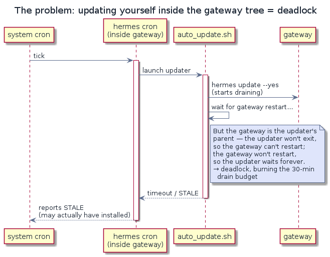

# Hermes Auto-Update

[简体中文](README.md) · English

Hands-off [Hermes Agent](https://github.com/NousResearch/hermes-agent) updates via a system-cron job outside the gateway process tree; notifies Telegram only for real outcomes.

Current version: **updater v5.15** (this is the updater's own version — distinct from the Hermes version it installs; see "v5.15 release notes" below).

## Support boundary / disclaimer

Hard-resets a git checkout and restarts a gateway as root, unattended. Linux + systemd + git installs only. Best-effort support.

## Why system cron, not hermes cron

<p align="center"></p>

A hermes-cron job lives inside the gateway process tree — the root of every update race: the updater can only signal a restart after it exits, waiting inside the script deadlocks, and the fleet check reports STALE. Out of the tree the updater drains the gateway, restarts it via systemd, and verifies the fleet itself before exiting, so the script can verify synchronously.

<p align="center"></p>

(Diagram sources: `assets/src/in-tree-deadlock.en.puml`, `assets/src/out-of-tree-flow.en.puml` — regenerate with `plantuml -tpng`.)

## Install

```bash
bash install.sh          # preconditions check ONLY — never runs the updater
```

The recommended schedule (install.sh prints it; crontab.txt carries it):

```cron
23 3 * * * set -a; [ -f $HOME/.hermes/scripts/auto_update.env ] && . $HOME/.hermes/scripts/auto_update.env; set +a; AU_APPLY=1 $HOME/.hermes/scripts/auto_update.sh >> $HOME/.hermes/logs/auto_update_cron.log 2>&1
```

`set -a` is not decoration: without it the env file delivers NOTHING to the script (a bare `. file` sets variables in the scheduler shell, which exits immediately, and the updater never sources the file itself). The `[ -f ]` guard keeps a not-yet-created env file from aborting the line before `AU_APPLY=1` is delivered. `scripts/schedule_delivery.sh` runs this shape under bash/dash/sh with the env file present and absent, and reports what the child inherited.

## Per-host values

| variable | why |
|---|---|
| `AU_APPLY=1` | REQUIRED in the scheduler command — absent = report-only, never installs |
| `TG_PROXY=""` (or empty value) | direct Telegram. **Must live in `~/.hermes/scripts/auto_update.env`** — the file the scheduler sources. A copy in `~/.hermes/.env` never arrives (the script reads that file only for bot token + chat id). Empty value is meaningful, never delete the var. |
| `AU_REPO_DIR` / `AU_HERMES_BIN` | non-default checkout / binary paths |
| `AU_GATEWAY_STATE` / `AU_GATEWAY_UNIT` / `AU_CRON_UNIT` | systemd specifics |
| `AU_CHECK_ALERT_INTERVAL` | check-failure re-alert interval in seconds (default `82800` = 1 day − 1h). Must be a positive integer; an invalid, empty, or `0` value falls back to the default |
| `AU_REALERT_SECS` | re-alert interval for real install failures and notify-delivery failures, seconds (default `255600` = 3 days − 1h). Same rules |
| `AU_ROLLBACK_REMIND_SECS` | reminder interval for "checkout newer than the selected release", seconds (default `601200` = 7 days − 1h). Same rules |

See SKILL.md + references/wsl-deployment.md for the full checklist.

## Notification design

Silence when up to date. `✓` on install (headline the Hermes version, name the updater version), `✗` on failure.

### How `update --check` is classified

Upstream `hermes update --check` has **no machine-readable output**: `--check` is a bare boolean flag (`hermes_cli/subcommands/update.py:18-20`) and every verdict is one `print()` followed by exit 0 (`hermes_cli/update_cmd_check.py:97-125`, `:191-228`; the file is byte-identical in v0.23.1 / v0.23.2 / upstream main 67e4d22). So the text is the contract, matched **whole line** against the upstream sentences (surrounding whitespace and one trailing CR trimmed):

| verdict | upstream sentence (`update_cmd_check.py`) | action |
|---|---|---|
| up to date | `:110` `✓ No newer release: {ahead label}.`, `:112` `✓ Up to date with the latest release ({label}).`, `:200/:208/:222` `✓ Already up to date.` | silent, no install, not a check failure |
| held | `:115` `→ Holding at this build: {label} predates the gateway runtime your sessions use.` | same, one log line |
| checkout newer than the selected release | `:119` `→ This checkout is newer than the selected release: {label}.` | NEVER an automatic `--yes` (it would downgrade); not a check failure; low-frequency reminder (`AU_ROLLBACK_REMIND_SECS`) for a human decision |
| update available | `:123` `→ Selected release available: {label}`, `:212/:225` `⚕ Update available: N commit(s) behind <ref>.`, `:214` `⚕ Update available (behind <ref>).` | reaches the `AU_APPLY` gate only; the version comes from the completion line (new `old → new` form: the destination; legacy single version), never from the check line |
| unknown | anything else | no install, counted as a check failure, alert on the 3rd in a row |

- `{label}` looks like `stable v0.23.2 (ae2a81ccc00e)` (`source_releases.py:61-65`). `No newer release` is printed only when `target.ahead` (`update_cmd_check.py:109-110`), and then the label is always the long "checkout is newer and waits for the next release" form (`source_releases.py:62-64`), so that sentence accepts **only** the long form; a short label after it never ships and is unknown.
- Older main-channel builds printed the same two sentences with the `☤` glyph (v2026.9.24), earlier with `⚕`; no release ever printed a glyph-less `--check` verdict, so a glyph-less line is not accepted.
- Known context lines carry no verdict and are accepted: `:97` channel banner, `:108` retired line, `:116-117/:120-121/:124/:215/:228` hints, `:143/:164` `→ Fetching from …...`, and the `  (…)` cleanup lines `:49/:52/:62/:65/:180/:183`.
- **Veto**: any line with `✗`, any line containing `error` / `failed` / `timed out` (any case), any other unrecognized non-empty line, or two different verdicts → the whole output is unknown. Alert rather than "no update" — and never install.

### `--yes` "nothing to do"

When `--yes` exits 0 without a receipt of its own for this run, the run counts as a no-op only if all of this holds:

- The conclusion is upstream's **exact** `--yes` no-op sentence (surrounding whitespace and a trailing CR trimmed; the ` [<branch> @ <short sha>]` suffix added by `_print_update_completion`, `update_cmd_maint.py:304-311`, is allowed):
  - `✓ Already up to date!` — `update_cmd.py:1730` (v0.23.1 `:1726`; v2026.9.24 `update_cmd.py:764`; a bare print in v2026.3.12 `main.py:1667`, v2026.6.19 `main.py:8798`, v2026.7.20 `main.py:10256`)
  - `✓ Up to date with your fork (official repo not checked).` — `update_cmd.py:1731` (v0.23.1 `:1727`; v2026.9.24 `update_cmd.py:765`)
  - `✓ Holding at this build until a newer <channel> release ships.` — `update_cmd.py:1915` (v0.23.1 `:1911`)
  - `✓ Already up to date.` (period) is only the `--check` sentence (`update_cmd_check.py:200/:208/:222`, and only `_cmd_update_check` in older builds) — **not** a `--yes` conclusion.
- Nothing in the same output vetoes it: a `✗` line; an error/failed/timed out line; an available / checkout-newer verdict; a line announcing **code movement** (`→ Post-swap hand-off: …`, `→ Switching to source commit`, `→ Found N new commit(s)`, `→ Pulling updates...`, `→ Pulling from upstream...`, `→ Syncing fork...`, `→ Rolling back to`, `✓ Code updated!`, ZIP update lines, …), which contradicts a no-op.
- **Only lines that claim a conclusion are judged**: after removing SGR colour codes, a trailing CR and surrounding whitespace, a line containing a conclusion keyword (any case: `up to date`, `holding at this build`, `no newer release`, `nothing to update`, `newer than the`, `release available`, `update(s) available`, `release status`, `release check`, `channel status`; sources in the `RE_YES_CONCL` comment of `auto_update.sh`) must be a **whole** upstream sentence holding no second keyword, else the no-op is vetoed. The upstream sentences come in three tables: the no-op conclusions `V_YES_NOOP`; the held explanation printed before the held conclusion, `→ This build is newer than the … release …: … nothing to update to yet.` (`update_cmd_check.py:323-324`, accepted only together with the held conclusion); and step reports naming their own subject, `V_YES_STEP` (`✓ Skills are up to date`, `✓ Configuration is up to date`, `✓ Fork is up to date with upstream`, TUI / Web UI / Desktop app, the fleet row `✓ <profile> (pid N) @ <sha> — up to date`, `◆ Search index update available`). So `✓ Already up to date? …`, `✓ Already up to date. (cached …)`, `→ Holding at this build? …`, the `--check` sentences and a conclusion hidden in a tail such as `→ Fleet: … Already up to date` are all vetoed.
- Lines without a conclusion keyword (the `☤` / `⚕ Updating Hermes Agent...` banners, `→ Fetching updates...`, `→ Fleet: …`, maintenance logs, indented or not) are neutral: there is **no whitelist of allowed lines**, so older builds' banners are no longer misjudged. Install output never goes through this veto — the receipt decides.

A vetoed no-op is a real failure (counted, alerted, exit 1, no reset). Every legitimate no-op (check time and `--yes` time) resets `consec_real_fails` after the drain recheck, so an old streak cannot swallow the next unrelated failure's first alert.

### Alert cadence (all wall clock)

| alert | first | then | knob (seconds) | default and why |
|---|---|---|---|---|
| check failing / unknown (`⚠`) | 3rd in a row | every `AU_CHECK_ALERT_INTERVAL` | `AU_CHECK_ALERT_INTERVAL` | `82800` (1 day − 1h): a stalled pipeline gets a daily reminder. The stamp is the **tick start** time, so the check's own duration (1s vs 300s) cannot shift the cadence. Daily ticks are still not exactly 86400s apart: stamps are whole seconds, so a tick that started 1s late followed by an on-time one is 86399s, and a local-time cron across a DST change is off by 1h. A zero-margin 86400 would slip the reminder a day in those cases, hence the 1h margin |
| real install failure (`✗`) | 1st, at once | every `AU_REALERT_SECS` | `AU_REALERT_SECS` | `255600` (3 days − 1h): the same broken install retried daily is one incident; every third daily tick keeps it visible without a daily page. The 1h margin absorbs scheduler jitter so it cannot slip to the 4th day |
| notify delivery failing (dead letter + meta-alert) | 3rd in a row | every `AU_REALERT_SECS` | same | the local `notify_dead_letter.log` entry IS the delivered artefact, so the stamp is written with it |
| checkout newer than the selected release (`→`) | on entering the state | every `AU_ROLLBACK_REMIND_SECS` | `AU_ROLLBACK_REMIND_SECS` | `604800 − 3600` (7 days − 1h): a human decision, not an emergency — a weekly nudge |

- Every stamp (`check_alert_last_ts`, `real_alert_last_ts`, `notify_alert_last_ts`, `rollback_remind_ts`) goes through one reader: empty, garbage, over-long, signed, or more than 300s in the future → "no stamp": alert now and overwrite on delivery (self-heal). Never a `set -u` crash, never silent forever.
- Stamps are written **only after delivery** (dead letter excepted, see above). A failed delivery is retried on the next tick.
- An invalid, empty, `0`, or longer-than-9-digit knob falls back to its default; `00060` reads as 60.
- Migration: a pre-existing counter above its threshold with no stamp alerts once on the next run; the old one-shot `rollback_notified` marker no longer silences the reminder forever.

### Alert content

Check-failure alerts carry the consecutive count, the last successful installation (`unknown` until the first proven install), and the real error: lines with `✗` / error / failed / timed out come first (each with the next line as context), the remaining budget is filled with the other lines in order, and only then is the summary bounded (6 lines, 200 bytes per line, 1000 bytes total). An error after a screen of cleanup chatter is not cut off.

An install is proven only by installation proof bound to the current invocation: a fresh, immutable receipt for THIS run plus an affirmative completion or code movement. Stale, missing, or unrelated (another operation, e.g. `kind=plugin-check`) or unchanged receipts never prove an install.

## v5.15 release notes

- `--check` verdicts are matched whole line against the upstream sentences, with the veto above; unknown output always alerts and never installs.
- A `--yes` no-op is accepted only on upstream's exact `--yes` sentence (`update_cmd.py:1730/:1731/:1915`) and only after the veto: only lines carrying a conclusion keyword are judged (each must be a whole upstream sentence), and a code-movement line beside the no-op is a conflict; banners and progress lines are neutral (no line whitelist any more, so the older `⚕ Updating Hermes Agent...` banner is no longer misjudged). A vetoed no-op is a real failure. Every legitimate no-op exit resets the real-failure counter.
- The check-failure re-alert defaults to `82800`s (1 day − 1h), a margin for start jitter and DST; `--check`'s `No newer release` accepts only the ahead label.
- Real failures, notify-delivery failures, and the checkout-newer reminder now follow a wall-clock cadence (new knobs `AU_REALERT_SECS`, `AU_ROLLBACK_REMIND_SECS`) instead of tick counts ("every 12th" was every 12 days on the daily schedule).
- The check-failure alert summary puts error lines first.
- **Behaviour change**: `--yes` exiting 0 without a fresh receipt of its own for this run is **no longer a success** — with a completion line → "install unproven" alert, `drain_pending` set, exit 1; unrecognized output → alert, exit 1. Hermes builds that write no update receipt therefore alert on every install; make sure the target Hermes writes `~/.hermes/logs/update_receipts/latest.json`.

## Files

- `auto_update.sh` — the updater (UPDATER_VERSION 5.15)
- `LICENSE` — MIT
- `scripts/release_gate.sh` — run BEFORE shipping: doc pointers + matrix + probes + teeth
- `scripts/schedule_delivery.sh` — does the recommended cron shape deliver env + flag?
- `scripts/marker_lifecycle_sweep.sh`, `scripts/counter_sanity.sh` — companion probes
- `scripts/check_compat_sanity.py` — `--check` outcome compatibility check, run as `python3 scripts/check_compat_sanity.py auto_update.sh`; part of the release gate
- `verify/` — hermetic harness (stub hermes/curl/systemctl); matrix = executable contract
- `references/` — receipt contract, WSL deployment, bundle recipe, health fixture

## Verify

From the extracted copy run:

```bash
bash scripts/release_gate.sh
```

Require PASS. The gate includes `python3 scripts/check_compat_sanity.py auto_update.sh`. The matrix and the compat probe are the executable contract of the script's behavior (they print their own tallies; counts are not restated here). Which test carries which acceptance point: `verify/README.md`.

sha256 (auto_update.sh, updater v5.15): `024692c223524a5c887ea0886557579ca86d9ad62bf5546905573a9b9bf1dd06`
_Regenerate with `sha256sum auto_update.sh` before re-packing._
