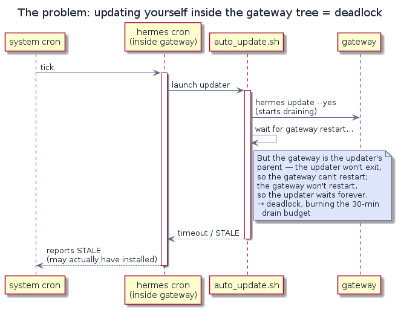
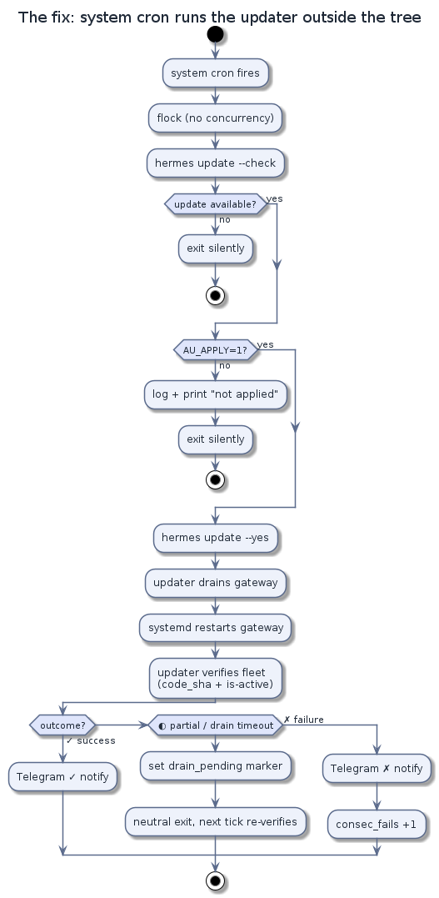

# Hermes Auto-Update

[简体中文](README.md) · English

Hands-off [Hermes Agent](https://github.com/NousResearch/hermes-agent) updates via a system-cron job outside the gateway process tree; notifies Telegram only for real outcomes.

Current version: **updater v5.14** (this is the updater's own version — distinct from the Hermes version it installs).

## Support boundary / disclaimer

Hard-resets a git checkout and restarts a gateway as root, unattended. Linux + systemd + git installs only. Best-effort support.

## Why system cron, not hermes cron

<p align="center"></p>

A hermes-cron job lives inside the gateway process tree — the root of every update race: the updater can only signal a restart after it exits, waiting inside the script deadlocks, and the fleet check reports STALE. Out of the tree the updater drains the gateway, restarts it via systemd, and verifies the fleet itself before exiting, so the script can verify synchronously.

<p align="center"></p>

(Diagram sources: `assets/src/in-tree-deadlock.en.puml`, `assets/src/out-of-tree-flow.en.puml` — regenerate with `plantuml -tpng`.)

## Install

```bash
bash install.sh          # preconditions check ONLY — never runs the updater
```

The recommended schedule (install.sh prints it; crontab.txt carries it):

```cron
23 3 * * * set -a; [ -f $HOME/.hermes/scripts/auto_update.env ] && . $HOME/.hermes/scripts/auto_update.env; set +a; AU_APPLY=1 $HOME/.hermes/scripts/auto_update.sh >> $HOME/.hermes/logs/auto_update_cron.log 2>&1
```

`set -a` is not decoration: without it the env file delivers NOTHING to the script (a bare `. file` sets variables in the scheduler shell, which exits immediately, and the updater never sources the file itself). The `[ -f ]` guard keeps a not-yet-created env file from aborting the line before `AU_APPLY=1` is delivered. `scripts/schedule_delivery.sh` runs this shape under bash/dash/sh with the env file present and absent, and reports what the child inherited.

## Per-host values

| variable | why |
|---|---|
| `AU_APPLY=1` | REQUIRED in the scheduler command — absent = report-only, never installs |
| `TG_PROXY=""` (or empty value) | direct Telegram. **Must live in `~/.hermes/scripts/auto_update.env`** — the file the scheduler sources. A copy in `~/.hermes/.env` never arrives (the script reads that file only for bot token + chat id). Empty value is meaningful, never delete the var. |
| `AU_REPO_DIR` / `AU_HERMES_BIN` | non-default checkout / binary paths |
| `AU_GATEWAY_STATE` / `AU_GATEWAY_UNIT` / `AU_CRON_UNIT` | systemd specifics |

See SKILL.md + references/wsl-deployment.md for the full checklist.

## Notification design

Silence when up to date. `✓` on install (headline the Hermes version, name the updater version), `✗` on failure, `⚠` when checks fail 3 consecutively then once per 24 further failures.

## Files

- `auto_update.sh` — the updater (UPDATER_VERSION 5.14)
- `LICENSE` — MIT
- `scripts/release_gate.sh` — run BEFORE shipping: doc pointers + matrix + probes + teeth
- `scripts/schedule_delivery.sh` — does the recommended cron shape deliver env + flag?
- `scripts/marker_lifecycle_sweep.sh`, `scripts/counter_sanity.sh` — companion probes
- `verify/` — hermetic harness (stub hermes/curl/systemctl); matrix = executable contract
- `references/` — receipt contract, WSL deployment, bundle recipe, health fixture

## Verify

From the extracted copy run:

```bash
bash scripts/release_gate.sh
```

Require PASS. The 62-scenario matrix is the executable contract of the script's behavior.

sha256 (auto_update.sh): `a6aff05b0e48e29e2c6e765f768f056c007be40c6afc56037e02042455f3f58d`
_Regenerate with `sha256sum auto_update.sh` before re-packing._
