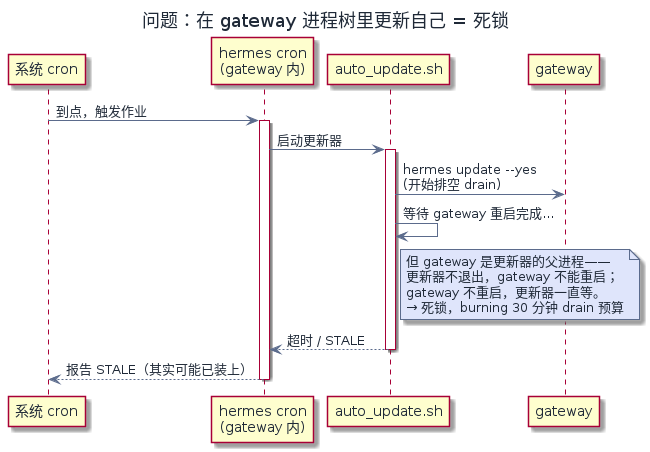

# Hermes 自动更新

（英文名：Hermes Auto-Update）

简体中文 · [English](README.en.md)

让 [Hermes Agent](https://github.com/NousResearch/hermes-agent) 自己更新自己：一条系统 cron 定时跑更新脚本，跑在 gateway 进程树之外，只在发生真实结果时才发 Telegram 通知。

当前版本：**updater v5.16**（这是更新器自身的版本号，和它安装的 Hermes 版本是两回事；变更见下文“v5.16 变更说明”与“v5.15 变更说明”）。

## 支持边界 / 免责声明

会 hard-reset 一个 git 检出、并以 root 无人值守地重启 gateway。仅适用 Linux + systemd + git 安装。尽力支持。

## 为什么是系统 cron，不是 hermes cron

<p align="center"></p>

hermes cron 作业活在 gateway 进程树里——这是所有更新竞态的根源：更新器只能在自己退出后通知重启，在脚本内等待重启必然死锁，fleet 检查必然报 STALE。放到进程树外，更新器可以自己排空 gateway、用 systemd 重启、退出前亲自验证 fleet，于是脚本可以同步验证。

<p align="center"></p>

（图源：`assets/src/in-tree-deadlock.puml`、`assets/src/out-of-tree-flow.puml`，用 `plantuml -tpng` 重新生成。）

## 安装

```bash
bash install.sh    # 只做前置检查——绝不运行更新器
```

推荐调度（install.sh 会打印，crontab.txt 里也有）：

```cron
23 3 * * * set -a; [ -f $HOME/.hermes/scripts/auto_update.env ] && . $HOME/.hermes/scripts/auto_update.env; set +a; AU_APPLY=1 $HOME/.hermes/scripts/auto_update.sh >> $HOME/.hermes/logs/auto_update_cron.log 2>&1
```

`set -a` 不是摆设：没有它，env 文件对脚本**什么都没传**（裸 `. file` 只把变量设在调度器 shell 里，它立刻退出，而更新器自己从不 source 这个文件）。`[ -f ]` 守卫防止 env 文件还没建时整行在 `AU_APPLY=1` 送达之前就中止。`scripts/schedule_delivery.sh` 在 bash/dash/sh 下各跑一遍这个调度形状（env 文件在/不在两种情况），报告子进程实际继承了什么。

## 各主机的变量

| 变量 | 作用 |
|---|---|
| `AU_APPLY=1` | 调度命令里**必须**带——不带 = 只报告、永不安装 |
| `TG_PROXY=""`（空值） | Telegram 直连。**必须放在 `~/.hermes/scripts/auto_update.env`** ——调度器 source 的那个文件。放 `~/.hermes/.env` 的副本永远到不了脚本（脚本读那个文件只为取 bot token + chat id）。空值是有效配置，别删这个变量。 |
| `AU_REPO_DIR` / `AU_HERMES_BIN` | 非默认检出 / 二进制路径 |
| `AU_GATEWAY_STATE` / `AU_GATEWAY_UNIT` / `AU_CRON_UNIT` | systemd 细节 |
| `AU_CHECK_ALERT_INTERVAL` | 检查失败告警的重发间隔（秒，默认 `82800` = 1 天 − 1 小时）。必须是正整数秒；非法值、空值或 `0` 都回退到默认值 |
| `AU_REALERT_SECS` | 真实安装失败、通知送达失败的重发间隔（秒，默认 `255600` = 3 天 − 1 小时）。规则同上 |
| `AU_ROLLBACK_REMIND_SECS` | “检出比所选正式版新”的提醒间隔（秒，默认 `601200` = 7 天 − 1 小时）。规则同上 |

完整清单见 SKILL.md 和 references/wsl-deployment.md。

## 通知设计

已是最新时静默。安装成功发 `✓`（标题写 Hermes 版本，注明 updater 版本），失败发 `✗`。安装成功但收据里还欠着 `user_action` / `followups` 时，`✓` 之后另发一条 `⚠` 待办提醒（v5.16，每个 `update_id` 一次，见“v5.16 变更说明”）。

### `update --check` 怎么判

上游 `hermes update --check` **没有机器可读输出**：`--check` 只是一个布尔参数（`hermes_cli/subcommands/update.py:18-20`），每种结论都是一行 `print()` 然后退出码 0（`hermes_cli/update_cmd_check.py:97-125`、`:191-228`；该文件在 v0.23.1 / v0.23.2 / 上游 main 67e4d22 字节一致）。所以文字就是契约，按**整行**匹配上游原句（去掉行首尾空白和一个行尾 CR）：

| 结论 | 上游原句（`update_cmd_check.py`） | 动作 |
|---|---|---|
| 已是最新 | `:110` `✓ No newer release: {ahead 长 label}.`、`:112` `✓ Up to date with the latest release ({label}).`、`:200/:208/:222` `✓ Already up to date.` | 静默，不安装，不算检查失败 |
| 暂缓（hold） | `:115` `→ Holding at this build: {label} predates the gateway runtime your sessions use.` | 同上，记一行日志 |
| 检出比所选正式版新 | `:119` `→ This checkout is newer than the selected release: {label}.` | **绝不**自动 `--yes`（会降级）；不算检查失败；按 `AU_ROLLBACK_REMIND_SECS` 低频提醒人工处理 |
| 有更新 | `:123` `→ Selected release available: {label}`、`:212/:225` `⚕ Update available: N commit(s) behind <ref>.`、`:214` `⚕ Update available (behind <ref>).` | 只进入 `AU_APPLY` 闸门；版本号从更新完成行取（新格式 `旧 → 新` 取后者，旧格式单一版本），不从检查行取 |
| 未知 | 其它一切 | 不安装，计入检查失败，连续第 3 次告警 |

- `{label}` 形如 `stable v0.23.2 (ae2a81ccc00e)`（`source_releases.py:61-65`）。`No newer release` 只在 `target.ahead` 时打印（`update_cmd_check.py:109-110`），此时 label 必为“检出更新、等下一个正式版”的长形式（`source_releases.py:62-64`），所以这一句**只认长形式**；短 label 跟在它后面从未出现，判为未知。
- 旧版 main 通道的同两句曾用 `☤` 字形（v2026.9.24），再早是 `⚕`；没有任何发布版打印过**无字形**的 `--check` 结论，所以无字形行不认。
- 只作上下文、不带结论的已知行：`:97` 通道横幅、`:108` retired 行、`:116-117/:120-121/:124/:215/:228` 提示行、`:143/:164` `→ Fetching from …...`、`:49/:52/:62/:65/:180/:183` 的 `  (…)` 清理日志行。
- **否决**：任何含 `✗` 的行、任何含 `error` / `failed` / `timed out`（不分大小写）的行、任何其它不认识的非空行、或出现两种不同结论 → 整体判为未知。宁可报警，不当“无更新”，更不安装。

### `--yes` 的“无事可做”（PATCH4 按可观测状态判；PATCH5：静默需要正面证据）

`--yes` 退出码 0 但本轮没有自己的**安装**收据时，**不看结论句**（前几轮按句子形状判，连续三轮在正常输出上来回误判/漏判，方向不收敛）。文本只用来找错误（只会多报），“能不能安静”只由本轮收据决定。按顺序：

1. 有更新完成行（`✓ Update complete…`）→ “安装未经证明”告警、设 `drain_pending`、退出 1（与 v5.15 相同）。
2. **错误否决**：去掉 SGR 颜色码、把行内 CR 换成空格、去首尾空白后，任一行**任意位置**含 `✗`（PATCH5，B1201：`ok\r✗ …` 是终端覆盖写），或含错误词（不分大小写、**整词**——两侧不是字母数字下划线；多词之间允许任意空白）：`error`、`failed`、`failure`、`timed out`、`could not`、`couldn't`（含 `’`）、`cannot`、`unable to`、`traceback` → 真实失败（计数、告警里带这一行、退出 1、不清零）。整词意味着 `0 failed` 会命中，`errors` / `unfailed` 不会。即使有本轮收据，错误行照样否决。
3. `--yes` 前后两次只读 `git rev-parse --verify HEAD`（`PRE_HEAD` / `POST_HEAD`），任一读不到（不是 40/64 位十六进制）→ 无法判断：告警、退出 1。
4. HEAD 变了 → 代码动了却没有本轮收据：“安装未经证明”告警、设 `drain_pending`、退出 1。
5. HEAD 没变 → 无事可做，不记安装（`mark_installed` 不调用），先做 drain 复核。然后分两支（PATCH5，方案 D）：
   - **5a 已证明（`PROVEN_NOOP=1`）**：本轮收据同时满足：`outcome=success`；`correlation_id` 等于脚本传给 `--yes` 的 `HERMES_UPDATE_CORRELATION_ID`；没有 `followups`、没有 `user_action`；`pre_update.short_sha == post_update.short_sha`，且观测到的 HEAD 以它开头。→ 清零 `consec_real_fails`，计入空转护栏，**静默退出 0**。
   - **5b 未证明（其它一切：没有收据、过期 / 别人的 / 字节未变 / 无 id 的收据、或收据里还欠着 followups）**→ 从**第 1 次**起发 ⚠ 提醒“检查说有更新但没装上，且没有本轮收据，请人工看一眼”，附 `--yes` 输出末尾 6 行；按 `AU_CHECK_ALERT_INTERVAL` 墙钟节流（与空转护栏共用 `available_noop_alert_last_ts`，只在送达后写）；**不**算真实失败（不计数、不用 ✗），**不**清零失败计数；**退出 1**（让调度日志看得见这次需要人看；计数器不动）。

为什么要求 `followups` 为空：上游在“已是最新”路径上同样跑依赖同步等收尾步骤；某一步失败时收据**仍是 `success`**，只在 `followups` 里列出欠下的步骤，打印的那一行（`⚠ Update follow-up '<step>' did not finish: …`）也不一定含错误词（实测收据：`verify/fixtures/receipt_noop_deps_owed_v0.23.2.json`）。所以“success”本身不是干净无事可做的证据。

### 上游三代收据（PATCH5 实测）

`--check` 没有机器可读输出（上一节）；`--yes` **自第三代起有收据**。逐个正式 tag 只读检查 `hermes_cli/update_receipt.py`（`verify/receipt_probe/receipt_generations.sh`，输出 `verify/receipt_probe/receipt_generations.txt`）：

| 代 | 版本范围 | tag 数 | 有收据模块 | 有 `correlation_id` | 本脚本的无事可做 |
|---|---|---|---|---|---|
| 一 | v2026.3.12 … v2026.8.18 | 28 | 无 | 无 | 一律 5b 提醒 |
| 二 | v2026.8.19 … v2026.9.24 | 8 | 有 | 无 | 一律 5b 提醒（收据不带本轮 id，证明不了是本轮的） |
| 三 | v0.21.6 … v0.23.2 | 13 | 有 | 有：`update_receipt.py:135-141` 读 `HERMES_UPDATE_CORRELATION_ID`，`:159` 写入 `correlation_id`；命令边界兜底落盘 `finalize_pending_update_receipt`（v0.23.2 `:869-892`） | 收据满足 5a 时静默，否则 5b |

第三代“已是最新”路径确实写这份收据：`update_cmd.py` 在判 `commit_count == 0` **之前**开收据（v0.23.2 `:1813` → `:1520-1526`，判定在 `:1923`；v0.21.6 `:1809` → `:1547-1553`，判定在 `:1942`），无事可做走 `_finish_already_up_to_date` → `_complete_source_update` → 收尾子进程 `update_completion._finish` 以 `success` 收尾。PATCH5 把第三代全部 13 个 tag 的这些**真实函数**逐个导出到隔离目录实跑（git / pip / gateway / 网络全换桩，`HERMES_HOME` 指向临时目录，curl 调用 0 次）：13 个都写出 `outcome=success`、`correlation_id` = 传入的 id、前后 SHA 相同、无 `followups` 的收据（探针 `verify/receipt_probe/receipt_noop_probe.py`，需要上游仓库，不在发布闸门内）。测试夹具 `verify/fixtures/receipt_noop_v0.23.2.json`、`verify/fixtures/receipt_noop_v0.21.6.json` 就是这几份原样收据。

### 不负责清单

以下情况按设计如此，不算缺陷：

1. **本工具是更新器，不监控宿主健康**：不检查 venv / 依赖、`state.db` 等数据、gateway 以外的运行时是否健康。检出已是最新时，`--check` 判“已是最新”，脚本根本不跑 `--yes`，看不见 venv 坏没坏。带本轮收据、上游判为 `success` 且没有 `followups` 的运行，脚本信任收据，不再解读文字里的 ⚠ 提示。
2. **没有本轮收据的版本上（第一、二代），每次“检查说有更新却没装上”都会提醒**（每 `AU_CHECK_ALERT_INTERVAL` 至多一次），包括完全正常的竞态无事可做。这是“静默需要正面证据”的代价，设计如此。
3. **pip / PyPI 安装形态不在范围内**（`--check` 的 `⚕ Update available on PyPI.` 判未知、不安装，见 `verify/upstream_error_review.json` 的 `check_registered`）。

错误词规则用全部正式发布版的上游 `print()` 模板验证过（`scripts/upstream_print_corpus.py`，快照 `verify/upstream_corpus.json`，见下文“上游措辞语料”）：命中的每一行都在 `verify/upstream_error_review.json` 里逐条登记为“报告失败”或“正常句”。正常句只有 4 句，按**上游整句**豁免（`auto_update.sh` 的 `V_YES_EXEMPT`，逐句附出处）：systemd 任务超时但已完成（状态限 active / inactive，`(failed)` 仍算错误）、`ℹ Got updates from upstream but couldn't push to fork (no write access?)`、两句 Windows 交接进度句。

### 空转护栏（`consec_available_noop`）

不再看句子之后，“检查说有更新、`--yes` 却每次都无事可做（而且收据证明了这一点）”会永远静默。所以：`--yes` 只在 `--check` 判“有更新”时才跑，每次无事可做（5a 与 5b 都）计一次 `consec_available_noop`；5b 从第 1 次就提醒（见上）；5a 连续第 3 次告警“检查说有更新但安装器连续无事可做——疑似卡住”，附检查行和最近一次 `--yes` 输出的末尾 6 行；之后按 `AU_CHECK_ALERT_INTERVAL`（默认 82800 秒）墙钟重报，时间戳 `available_noop_alert_last_ts` 只在送达后写入。**清零**：每次经证明的安装（`mark_installed`），以及 `--check` 判已是最新 / 暂缓 / 检出比所选正式版新。中间夹着检查失败或安装失败**不清零也不计数**（什么都没装上，间歇性故障不能掩盖卡住）。

这也是 B500 两条不含错误词的旧反例（`✓ Already up to date. (cached result from yesterday)`、`→ Holding at this build? Channel status unavailable.`）的新结论：HEAD 没动 = 没装任何东西；没有本轮收据 → 第 1 次就提醒；有本轮收据证明 → 静默，若反复出现由空转护栏在第 3 次告警。

### 告警节奏（全部按墙钟）

| 告警 | 首次 | 之后 | 变量（秒） | 默认值与理由 |
|---|---|---|---|---|
| 检查失败 / 未知（`⚠`） | 连续第 3 次 | 每 `AU_CHECK_ALERT_INTERVAL` | `AU_CHECK_ALERT_INTERVAL` | `82800`（1 天 − 1 小时）：流水线卡住每天提醒一次。时间戳记的是**本次 tick 的启动时刻**，所以检查本身耗时 1 秒还是 300 秒不影响节奏；但每日 tick 的间隔并不精确等于 86400 秒——时间戳按整秒取，前一次晚 1 秒启动、这一次准点，就只差 86399 秒；按本地时间调度的 cron 跨夏令时还会差出 1 小时。零余量的 86400 会因此把提醒顺延一天，所以留 1 小时余量 |
| 真实安装失败（`✗`） | 第 1 次立即 | 每 `AU_REALERT_SECS` | `AU_REALERT_SECS` | `255600`（3 天 − 1 小时）：每日重试的同一个坏安装是同一事件，每第 3 个每日 tick 提醒一次；减 1 小时是给调度抖动的余量，避免顺延到第 4 天 |
| 通知送达失败（死信 + 附加告警） | 连续第 3 次 | 每 `AU_REALERT_SECS` | 同上 | 本地死信 `notify_dead_letter.log` 就是“已送达”的产物，所以与死信同时写时间戳 |
| 检出比所选正式版新（`→`） | 进入该状态时 | 每 `AU_ROLLBACK_REMIND_SECS` | `AU_ROLLBACK_REMIND_SECS` | `604800 − 3600`（7 天 − 1 小时）：需要人做决定，不是紧急事件，每周提醒一次 |
| 有更新却连续无事可做，收据已证明（空转护栏，`⚠`） | 连续第 3 次 | 每 `AU_CHECK_ALERT_INTERVAL` | 同检查告警 | `82800`：和检查告警同一种“流水线卡住”，同样每天提醒一次 |
| 有更新却没装上，且没有本轮收据（5b，`⚠`） | 第 1 次 | 每 `AU_CHECK_ALERT_INTERVAL` | 同检查告警 | `82800`：没有证据就不安静；不算失败，所以用检查告警的节奏而不是真实失败的节奏 |
| 安装成功但收据欠着 `user_action` / `followups`（v5.16，`⚠`） | 那次安装，`✓` 之后 | 不重发；未送达则每个 tick 开头重试直到送达 | 无 | 每个 `update_id` 只提醒一次（`owed_action_notified` 送达后才写）；要人动手的事说一次就够，送达前不放弃 |

- 所有时间戳（`check_alert_last_ts`、`real_alert_last_ts`、`notify_alert_last_ts`、`rollback_remind_ts`、`available_noop_alert_last_ts`）都经同一个读取器：空、乱码、超长、负号、或比现在晚 300 秒以上 → 视为“没有时间戳”，立即告警，送达后覆盖（自愈），不会让 `set -u` 崩溃，也不会永久静默。
- 时间戳**只在送达后**写入（死信例外，见上）。送达失败时，下一次 tick 重试。
- 变量非法、为空、为 `0` 或超过 9 位 → 回退默认值；`00060` 解析为 60。
- 迁移：旧版本留下的计数如果已经大于阈值、又没有时间戳，下一次会告警一次；旧的一次性标记 `rollback_notified` 不再让提醒永久静默。

### 告警内容

检查失败告警带连续失败次数、上次成功安装时间（在首次经证明的安装之前显示“unknown”）、以及真实错误摘要：先选含 `✗` / error / failed / timed out 的行（各带下一行作上下文），剩余名额再按顺序补其它行，最后才限长（6 行、每行 200 字节、总计 1000 字节）。错误排在一屏清理日志之后也不会被截掉。

只有绑定到本次调用的安装证明才能证明一次安装：一份新鲜的、不可变的本次运行收据，加上肯定的完成结果或代码变动。过期的、缺失的、属于其他操作（如 `kind=plugin-check`）的或无变化的收据都不能证明安装。

## v5.16 变更说明

- **安装成功时转达上游的待办**（2026-11-18 事故：v0.23.1→v0.23.2 的安装判对了，但收据里的 `user_action`——`local_changes`，本地改动被 stash 搁置、没有恢复，附 stash ref 和重新应用命令——没有告诉任何人）。现在凡是走到 `mark_installed` 的成功路径（带本轮 id 的 success、partial + SHA 前进且退出码 0、退出码非 0 的竞态分支、旧版收据靠本轮证据接受）都读同一份收据快照里的 `user_action` 与 `followups`：只要任一非空，就在 ✓ 通知之后另发**一条** ⚠ 提醒，列出 `user_action` 的 `step` / `reason` 原文与每个 followup 的 `step` / `reason`（去掉转义序列和控制字符、空白压成一行；每条 reason 至多 600 字符——上游自己截到 500，所以 stash ref 与重新应用命令完整保留；follow-up 放到 3300 字节为止，其余计数；整条按字节 ≤ 3500）。
  - **不改变安装判定**：仍 `mark_installed`、仍清零计数，各路径的退出码与 v5.15 完全相同（success 0、partial 退出码 0 两支 0、竞态分支 0）；提醒送达与否都不影响。
  - **送达**：先把提醒写进 `state/auto_update/owed_action_pending/<key>`，再在 ✓ 之后投递；送达失败按 notify 自己的失败路径计数（连续第 3 次写死信并附加告警），提醒留在队列里，**以后每个 tick 开头**重试，直到送达。gateway 轮询途中脚本被杀也不会丢。
  - **去重**：`<key>` = 收据的 `update_id`（缺失 / 非法时用快照的 sha256），**送达后**才追加到 `state/auto_update/owed_action_notified`；同一 `update_id` 再出现只记日志、不再提醒。
  - **“已入队”可核查**（PR #4 第 1 修复轮，审查 B1500 / B1501 / B1604）：只有读回校验过的普通提醒文件才算已入队；队列目录写不了（不是目录、不可写、mktemp/mv 失败）时改写 state 目录根下的备用文件 `owed_action_fallback.<key>`，同样每个 tick 重试直到送达；同名目录 / 坏文件被改名隔离（`.owed_bad.*`，不删除）并记日志，flush 不会静默跳过，坏条目代表的提醒按 key 重建（`gen-<key>`，真提醒到了就作废）；去重账本写入读回确认后才删待办，账本是目录 / 只读时先隔离再重建（保留原有 key），实在写不了就把待办改名为“已送达”标记；中断留下的 `.owed_q.*` 临时文件下次 flush 恢复。所有持久位置都写不了时：直接发一次，失败则全文写进日志并打到 stderr（cron 行把 stderr 写进 `auto_update_cron.log`），安装判定、计数与退出码不变。
  - 字段异常（字符串、列表、数字、布尔、null、超长、非 dict 条目、空 dict）不崩溃，也不永久静默：任何真值的 `user_action` / `followups` 都会提醒；空值（`null`、`""`、`[]`、`{}`、`false`、`0`）= 没有待办，与 v5.15 输出完全一致。
  - 无事可做 / 失败路径不变：欠着待办的无事可做收据本来就不算证明（5b 提醒），失败仍是失败。
- **B1300 加固**（`receipt_sha_advanced`）：不再凭 `short_sha` 字符串不等判“代码前进”。每一侧优先取完整 `sha`（40/64 位十六进制），否则取 `short_sha`（≥ 7 位十六进制），不分大小写；`short_sha` 不是同侧完整 `sha` 的前缀 = 收据自相矛盾 = 不算前进。两侧都有完整 sha 时比完整 sha；否则按较短者的长度比前缀——长度不同但互为前缀（r7A 伪造收据：`sha` 相同、`short_sha` 7 位对 8 位）= 同一提交 = **未前进**。
- 回归：`scripts/check_compat_sanity.py` 新增 `OwedActionNotice`（夹具 `verify/fixtures/receipt_partial_user_action_v0.23.2.json` = 11-18 真实收据，字段结构照抄，主机路径 / profile 名 / 启动 id 已脱敏）与 `ShaAdvanceB1300`；发布闸门新增 5 个变异（删提醒、删去重、未送达也记已送达、删 tick 开头重试、恢复旧 `receipt_sha_advanced`），各须变红。修复轮 1 再加入口级 `OwedActionPersistence`（r8A 三个场景：入队失败 + 通道恢复、待办 key 是目录、去重账本是目录；外加全部持久位置不可写、只读账本、账本不可恢复、`.owed_q.*` 残留）与 4 个变异（删备用持久化、恢复 `-e` 判断、删账本写入检查、删临时文件恢复）。

## v5.15 变更说明

- `--check` 结论按上游整行原句匹配并加否决（见上），未知输出一律报警、不安装。
- `--yes` 无收据时按可观测状态判（PATCH4，见上）：错误行 → 真实失败；HEAD 读不到 → 无法判断告警；HEAD 变了 → 安装未经证明；HEAD 没变 → 无事可做。不再看结论句，删除了结论关键词表、步骤句表和代码移动词表。新增空转护栏（检查说有更新而 `--yes` 连续第 3 次无事可做 → 告警）。
- **静默需要正面证据**（PATCH5，方案 D，见上）：只有本轮收据（`success`、`correlation_id` 是本轮的、无 `followups` / `user_action`、前后 SHA 等于观测 HEAD）证明的无事可做才静默并清零真实失败计数；其它无事可做从第 1 次起 ⚠ 提醒、不算失败、不清零、退出 1。第一、二代 Hermes（v2026.3.12 – v2026.9.24）没有带 id 的收据，所以在这些版本上每次“有更新却没装上”都会提醒。错误否决改为行内任意位置的 `✗`（B1201）。语料扫描工具遇到解析错误、某 tag 零 `print()`、或 (a)/(b) 语料为空时失败（B1102）。
- 新增 `scripts/upstream_print_corpus.py`：逐个扫描全部正式发布版的更新代码 `print()` 模板，检查 `--check` 分类与 `--yes` 错误词规则，快照进 `verify/upstream_corpus.json`，发布闸门执行。
- 检查失败重报默认 `82800` 秒（1 天 − 1 小时），给启动抖动和夏令时留余量；`--check` 的 `No newer release` 只认 ahead 长 label。
- 真实失败、通知送达失败、“检出更新”提醒都改为按墙钟节奏（新变量 `AU_REALERT_SECS`、`AU_ROLLBACK_REMIND_SECS`），不再按 tick 次数（每日调度下“每 12 次”= 12 天）。
- 检查失败告警摘要优先选错误行。
- **行为变化**：`--yes` 退出码 0 但本轮没有自己的新鲜收据时，**不再当作成功**——有完成行 → “安装未经证明”告警、设 `drain_pending`、退出 1；其余按上面的可观测状态判（PATCH4 起：输出不认识但没有错误行、HEAD 没变 → 无事可做；PATCH5 起，只有本轮收据证明的无事可做才静默，否则 ⚠ 提醒；HEAD 变了 → 安装未经证明）。不写更新收据的 Hermes 构建因此每次安装都会告警；请确认目标 Hermes 版本会写 `~/.hermes/logs/update_receipts/latest.json`。

## 上游措辞语料

`--check` 没有机器可读输出，`--yes` 的收据也只有第三代才带本轮 id（见“上游三代收据”），所以两处文本规则（`--check` 结论分类、`--yes` 错误词）必须对**每个**正式发布版都成立，而不只是最新版。`scripts/upstream_print_corpus.py`（只读：`git tag` / `git ls-tree` / `git show <tag>:<path>`，不 fetch、不 checkout，逐个 tag 串行）：

- 列出全部正式发布 tag（`vX.Y.Z` 与 `vYYYY.M.D[.N]`；rc / canary / abandoned / `+` 构建元数据 / 其它名字全部排除并计数）；
- 每个 tag 读 `hermes_cli/update_cmd*.py`、`update_handoff.py`、`update_pause_record.py`、`source_releases.py` 整个文件，以及旧版 `hermes_cli/main.py` 里从 `cmd_update` / `_cmd_update_impl` / `_cmd_update_check` 可达的函数；用 `ast` 取出全部 `print(...)` 模板（f-string 等的变量部分保留为 `<<表达式>>` 占位符）；
- (a) 从 `_cmd_update_check` 可达的模板按真源 label 形状实例化后喂给 `auto_update.sh` 里真正的 `classify_line`：宣告结论的行判 `unknown` 即失败（已登记的发现除外，见 `verify/upstream_error_review.json` 的 `check_registered`）；
- (b) 全部模板行喂给真正的 `yes_error_line`（先关掉豁免表）：每一处命中必须在 `verify/upstream_error_review.json` 里登记为 `error` 或 `exempt`；再打开豁免表复核：豁免样例必须放行、每一条 `error` 行仍须否决。

去重后的语料快照在 `verify/upstream_corpus.json`（不超过 512KB），发布闸门对它执行 `--gate`（收件方没有上游仓库也能跑）。扫描本身必须有内容才算数（PATCH5，B1102）：任何源文件解析失败、任何 tag 一个 `print()` 都没扫到、或 (a) / (b) 一行都没检查到，普通模式和 `--gate` 都返回非零；`scripts/check_compat_sanity.py` 的 `CorpusToolFailsClosed` 用坏源码夹具回归。上游出新版本后：`python3 -I scripts/upstream_print_corpus.py --write-snapshot`，新命中会以“未登记”让闸门失败，逐条登记后再发布。局限：只看得到 `print()`；`logger`、`sys.stdout.write`、子进程（pip、git、npm、systemctl）的输出，以及在别处拼好再传给 `print` 的字符串，看不到或只剩占位符；`print(end="")` 的跨行拼接不还原。占位符在运行时的内容（profile 名、分支名、异常信息）不在证明范围内。

## 文件

- `auto_update.sh` —— 更新器本体（UPDATER_VERSION 5.16）
- `LICENSE` —— MIT
- `scripts/release_gate.sh` —— 发布前必跑：文档指针 + 测试矩阵 + 探针 + 破坏性验证（teeth）
- `scripts/schedule_delivery.sh` —— 验证推荐调度形状是否真的送达 env 和 flag
- `scripts/marker_lifecycle_sweep.sh`、`scripts/counter_sanity.sh` —— 配套探针
- `scripts/check_compat_sanity.py` —— `--check` 结果兼容性检查，运行方式为 `python3 scripts/check_compat_sanity.py auto_update.sh`，属于发布闸门的一部分
- `scripts/upstream_print_corpus.py` —— 全部正式发布版的上游措辞扫描（见“上游措辞语料”）；`verify/upstream_corpus.json` 语料快照，`verify/upstream_error_review.json` 错误词命中逐条登记
- `verify/` —— 全封闭测试具（stub hermes/curl/systemctl）；矩阵即契约的可执行形式
- `verify/fixtures/` —— 上游真实函数写出的第三代无事可做收据（原样），以及 11-18 真实安装收据（partial + `user_action`，脱敏），测试夹具
- `verify/receipt_probe/` —— 生成这些收据的隔离探针与三代收据扫描（需要上游仓库；只读，不跑 `hermes update`）
- `references/` —— 收据字段契约、WSL 部署、打包验证、健康夹具

## 验证

从解压后的目录跑：

```bash
bash scripts/release_gate.sh
```

要求 PASS。闸门包含 `python3 scripts/check_compat_sanity.py auto_update.sh`。矩阵和兼容探针是脚本行为的可执行契约（场景数以它们自己打印的统计为准，不在文档里抄写）；验收点与测试的对应关系见 `verify/README.md`。

sha256（auto_update.sh，updater v5.16）: `81133eb66b15356fa1db05e7a78972fc5b80a941b562e4961f53606e72f5c92e`
_重新打包前用 `sha256sum auto_update.sh` 重新生成。_
