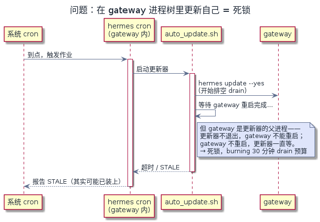
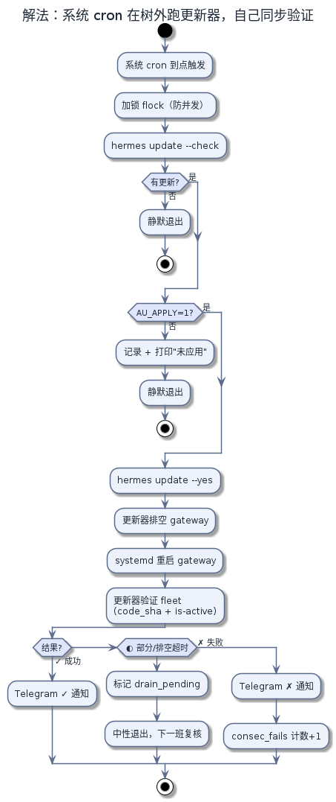

# Hermes 自动更新

（英文名：Hermes Auto-Update）

简体中文 · [English](README.en.md)

让 [Hermes Agent](https://github.com/NousResearch/hermes-agent) 自己更新自己：一条系统 cron 定时跑更新脚本，跑在 gateway 进程树之外，只在发生真实结果时才发 Telegram 通知。

当前版本：**updater v5.14**（这是更新器自身的版本号，和它安装的 Hermes 版本是两回事）。

## 支持边界 / 免责声明

会 hard-reset 一个 git 检出、并以 root 无人值守地重启 gateway。仅适用 Linux + systemd + git 安装。尽力支持。

## 为什么是系统 cron，不是 hermes cron

<p align="center"></p>

hermes cron 作业活在 gateway 进程树里——这是所有更新竞态的根源：更新器只能在自己退出后通知重启，在脚本内等待重启必然死锁，fleet 检查必然报 STALE。放到进程树外，更新器可以自己排空 gateway、用 systemd 重启、退出前亲自验证 fleet，于是脚本可以同步验证。

<p align="center"></p>

（图源：`assets/src/in-tree-deadlock.puml`、`assets/src/out-of-tree-flow.puml`，用 `plantuml -tpng` 重新生成。）

## 安装

```bash
bash install.sh    # 只做前置检查——绝不运行更新器
```

推荐调度（install.sh 会打印，crontab.txt 里也有）：

```cron
23 3 * * * set -a; [ -f $HOME/.hermes/scripts/auto_update.env ] && . $HOME/.hermes/scripts/auto_update.env; set +a; AU_APPLY=1 $HOME/.hermes/scripts/auto_update.sh >> $HOME/.hermes/logs/auto_update_cron.log 2>&1
```

`set -a` 不是摆设：没有它，env 文件对脚本**什么都没传**（裸 `. file` 只把变量设在调度器 shell 里，它立刻退出，而更新器自己从不 source 这个文件）。`[ -f ]` 守卫防止 env 文件还没建时整行在 `AU_APPLY=1` 送达之前就中止。`scripts/schedule_delivery.sh` 在 bash/dash/sh 下各跑一遍这个调度形状（env 文件在/不在两种情况），报告子进程实际继承了什么。

## 各主机的变量

| 变量 | 作用 |
|---|---|
| `AU_APPLY=1` | 调度命令里**必须**带——不带 = 只报告、永不安装 |
| `TG_PROXY=""`（空值） | Telegram 直连。**必须放在 `~/.hermes/scripts/auto_update.env`** ——调度器 source 的那个文件。放 `~/.hermes/.env` 的副本永远到不了脚本（脚本读那个文件只为取 bot token + chat id）。空值是有效配置，别删这个变量。 |
| `AU_REPO_DIR` / `AU_HERMES_BIN` | 非默认检出 / 二进制路径 |
| `AU_GATEWAY_STATE` / `AU_GATEWAY_UNIT` / `AU_CRON_UNIT` | systemd 细节 |

完整清单见 SKILL.md 和 references/wsl-deployment.md。

## 通知设计

已是最新时静默。安装成功发 `✓`（标题写 Hermes 版本，注明 updater 版本），失败发 `✗`，检查连续失败 3 次发 `⚠`，之后每 24 次失败再发一次。

## 文件

- `auto_update.sh` —— 更新器本体（UPDATER_VERSION 5.14）
- `LICENSE` —— MIT
- `scripts/release_gate.sh` —— 发布前必跑：文档指针 + 测试矩阵 + 探针 + 破坏性验证（teeth）
- `scripts/schedule_delivery.sh` —— 验证推荐调度形状是否真的送达 env 和 flag
- `scripts/marker_lifecycle_sweep.sh`、`scripts/counter_sanity.sh` —— 配套探针
- `verify/` —— 全封闭测试具（stub hermes/curl/systemctl）；矩阵即契约的可执行形式
- `references/` —— 收据字段契约、WSL 部署、打包验证、健康夹具

## 验证

从解压后的目录跑：

```bash
bash scripts/release_gate.sh
```

要求 PASS。矩阵的 62 个场景是脚本行为的可执行契约。

sha256 (auto_update.sh): `a6aff05b0e48e29e2c6e765f768f056c007be40c6afc56037e02042455f3f58d`
_重新打包前用 `sha256sum auto_update.sh` 重新生成。_
