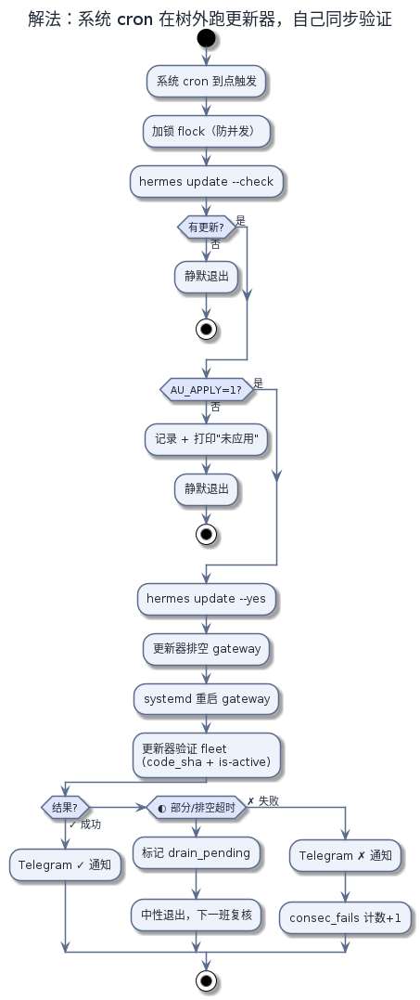

# Hermes 自动更新

（英文名：Hermes Auto-Update）

简体中文 · [English](README.en.md)

让 [Hermes Agent](https://github.com/NousResearch/hermes-agent) 自己更新自己：一条系统 cron 定时跑更新脚本，跑在 gateway 进程树之外，只在发生真实结果时才发 Telegram 通知。

当前版本：**updater v5.15**（这是更新器自身的版本号，和它安装的 Hermes 版本是两回事）。

## 支持边界 / 免责声明

会 hard-reset 一个 git 检出、并以 root 无人值守地重启 gateway。仅适用 Linux + systemd + git 安装。尽力支持。

## 为什么是系统 cron，不是 hermes cron

<p align="center"></p>

hermes cron 作业活在 gateway 进程树里——这是所有更新竞态的根源：更新器只能在自己退出后通知重启，在脚本内等待重启必然死锁，fleet 检查必然报 STALE。放到进程树外，更新器可以自己排空 gateway、用 systemd 重启、退出前亲自验证 fleet，于是脚本可以同步验证。

<p align="center"></p>

（图源：`assets/src/in-tree-deadlock.puml`、`assets/src/out-of-tree-flow.puml`，用 `plantuml -tpng` 重新生成。）

## 安装

```bash
bash install.sh    # 只做前置检查——绝不运行更新器
```

推荐调度（install.sh 会打印，crontab.txt 里也有）：

```cron
23 3 * * * set -a; [ -f $HOME/.hermes/scripts/auto_update.env ] && . $HOME/.hermes/scripts/auto_update.env; set +a; AU_APPLY=1 $HOME/.hermes/scripts/auto_update.sh >> $HOME/.hermes/logs/auto_update_cron.log 2>&1
```

`set -a` 不是摆设：没有它，env 文件对脚本**什么都没传**（裸 `. file` 只把变量设在调度器 shell 里，它立刻退出，而更新器自己从不 source 这个文件）。`[ -f ]` 守卫防止 env 文件还没建时整行在 `AU_APPLY=1` 送达之前就中止。`scripts/schedule_delivery.sh` 在 bash/dash/sh 下各跑一遍这个调度形状（env 文件在/不在两种情况），报告子进程实际继承了什么。

## 各主机的变量

| 变量 | 作用 |
|---|---|
| `AU_APPLY=1` | 调度命令里**必须**带——不带 = 只报告、永不安装 |
| `TG_PROXY=""`（空值） | Telegram 直连。**必须放在 `~/.hermes/scripts/auto_update.env`** ——调度器 source 的那个文件。放 `~/.hermes/.env` 的副本永远到不了脚本（脚本读那个文件只为取 bot token + chat id）。空值是有效配置，别删这个变量。 |
| `AU_REPO_DIR` / `AU_HERMES_BIN` | 非默认检出 / 二进制路径 |
| `AU_GATEWAY_STATE` / `AU_GATEWAY_UNIT` / `AU_CRON_UNIT` | systemd 细节 |
| `AU_REALERT_SECS` | 持续故障的重复告警间隔（秒，墙钟时间），默认 `259200`（3 天）；`0` = 每次运行都提醒。非数字值按默认处理 |
| `AU_AHEAD_REMIND_SECS` | 「检出比所选正式版更新」提醒间隔（秒），默认 `604800`（7 天） |

完整清单见 SKILL.md 和 references/wsl-deployment.md。

## 通知设计

已是最新时静默。安装成功发 `✓`（标题写 Hermes 版本，注明 updater 版本），失败发 `✗`（首次立即发，持续失败则每 `AU_REALERT_SECS` 再发）。检查连续异常（`--check` 退出码非 0，或输出无法识别）达到 3 次发 `⚠`，之后按**墙钟时间**每 `AU_REALERT_SECS`（默认 3 天）再发一次；告警正文带真实错误行（优先 `✗` 开头的行）、连续异常次数和最后一次成功安装时间。

`hermes update --check` 的输出按行首锚定的固定措辞归类（依据 Hermes `hermes_cli/update_cmd_check.py`，上游没有机器可读输出）：

| Hermes 打印 | 归类 | 动作 |
|---|---|---|
| `⚕ Update available…`（main）/ `→ Selected release available: …`（stable） | 有更新 | 安装（需 `AU_APPLY=1`） |
| `✓ Already up to date.` / `✓ No newer release: …` / `✓ Up to date with the latest release (…)` | 无更新 | 静默，清零检查异常计数 |
| `→ Holding at this build: …` | 暂不更新 | 不安装、不计失败，记一行日志 |
| `→ This checkout is newer than the selected release: …` | 检出比正式版新 | **不安装**（安装会退回旧版），不计失败，最多每 7 天提醒一次由人决定 |
| 其它、互相矛盾的多种结论、或含 `✗` 行 | 无法识别 | 计入检查异常，按上面的节奏告警 |

## 文件

- `auto_update.sh` —— 更新器本体（UPDATER_VERSION 5.15）
- `LICENSE` —— MIT
- `scripts/release_gate.sh` —— 发布前必跑：文档指针 + 测试矩阵 + 探针 + 破坏性验证（teeth）
- `scripts/schedule_delivery.sh` —— 验证推荐调度形状是否真的送达 env 和 flag
- `scripts/marker_lifecycle_sweep.sh`、`scripts/counter_sanity.sh` —— 配套探针
- `verify/` —— 全封闭测试具（stub hermes/curl/systemctl）；矩阵即契约的可执行形式
- `references/` —— 收据字段契约、WSL 部署、打包验证、健康夹具

## 验证

从解压后的目录跑：

```bash
bash scripts/release_gate.sh
```

要求 PASS。测试矩阵是脚本行为的可执行契约（场景数以矩阵自己打印的尾行为准）。

## 更新日志

**v5.15**（修复 [#1](https://github.com/getaskclaw/hermes-auto-update/issues/1)）

- stable 通道的 `--check` 输出此前全部落入「无法识别」，包括 `→ Selected release available`——stable 实例从不安装。现按上表归类；`This checkout is newer than the selected release` 永不自动安装。
- 重复告警改为按墙钟时间限流（`AU_REALERT_SECS`，默认 3 天），取代按运行次数的 `N == 3 || N % 24 == 0`（每日调度下是第 3 天、第 24 天）。真实安装失败、通知通道失效的重复提醒同样改为按时间。时间戳文件损坏、溢出或处于未来时按「从未告警」处理，只会让告警提前，不会让它消失。
- 检查失败通知带真实错误行、连续异常次数、最后一次成功安装时间（新状态文件 `last_install_ok`）。
- 成功通知的版本号从完成行取最后一个 `vX.Y.Z`，兼容 `(v0.23.0 → v0.23.1) [detached @ …]` 新格式和 `(v0.21.4)` 旧格式。
- `hermes update --yes` 实际无事可做（`✓ Already up to date!`、`✓ Holding at this build until a newer …`）但写了新收据时，不再误报「已更新」。

**v5.14 及更早**：见 `auto_update.sh` 文件头。

sha256 (auto_update.sh): `e6f1a73201a10779c1464815bd990b9322f8c099c0c5fd0a6e0f2315d7d97ce8`
_重新打包前用 `sha256sum auto_update.sh` 重新生成。_
